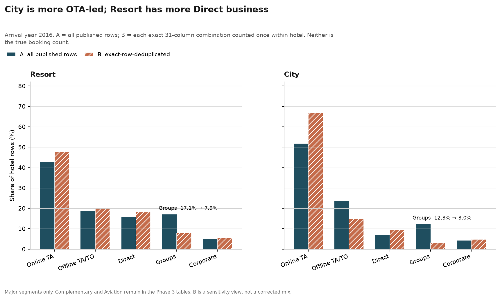
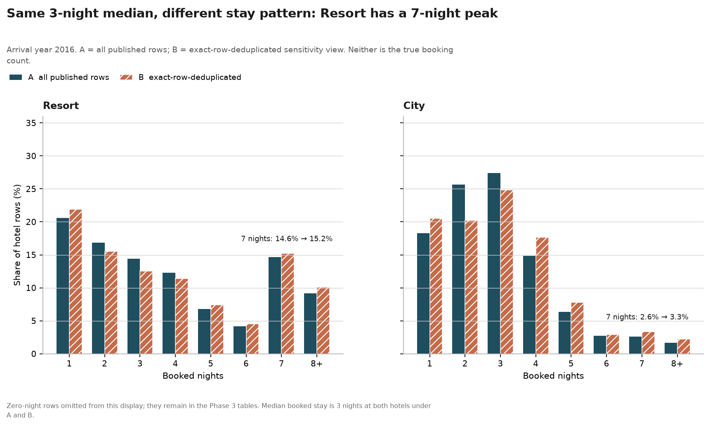
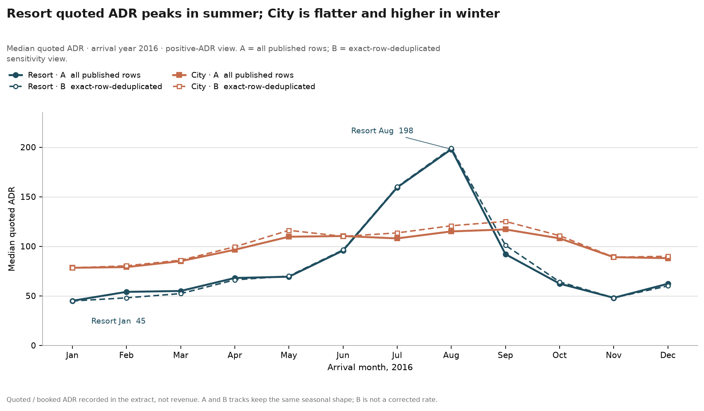
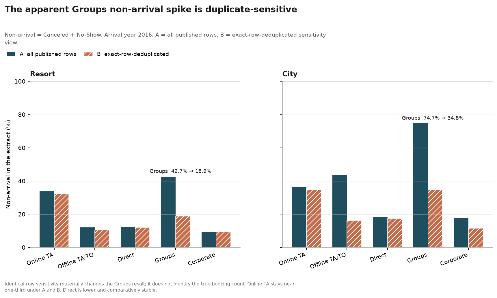

# Hospitality Revenue Analytics

Commercial analysis of booking mix, quoted rates, and non-arrival for two anonymised Portuguese hotels — and a test of which conclusions survive unresolved exact-duplicate rows.

This project compares one **resort hotel** and one **city hotel** in the António, Almeida & Nunes (2019) hotel booking demand extract. It supports revenue-management *decision framing* using mix, stay pattern, quoted ADR, and final booking outcome. It does **not** calculate realised revenue.

The files are anonymised academic extracts from Portugal (H1 = Resort, H2 = City). **This is not Hilton data.** ADR is the quoted / booked rate recorded in the extract. The dataset has no auditable revenue, occupancy, RevPAR, GOPPAR, or room inventory.

The primary window is **arrival year 2016**, the only complete calendar year.

## What I found

1. **City mix is more intermediary-led; Resort has more Direct business.** Online TA is 42.8% (A) / 47.8% (B) at Resort vs 51.7% / 66.8% at City. Direct is 15.9% / 18.2% at Resort vs 7.1% / 9.3% at City. The more stable channel view is TA/TO: about 72% Resort vs 84–87% City under both conventions. City Online TA 66.8% is a sensitivity reading, not *the* mix number.
2. **Both hotels have a 3-night median stay; the shapes differ.** Resort has a 7-night peak (14.6% A / 15.2% B) that City lacks (2.6% / 3.3%).
3. **Typical quoted ADR is higher at City than at Resort** under every A/B and published/positive view. Published medians: Resort 70 (A) / 71 (B); City 99 / 102.60. Positive-ADR medians: 71 / 72 vs 99.45 / 103.50. That is a booked rate, not money collected.
4. **Seasonal quoted ADR differs.** Resort jumps from about 45 in January to about 159 in July and 198 in August. City is flatter and already about 78 in January, with a 2016 high around September (117 A / 125 B).
5. **City non-arrival is higher under both counting rules; the gap shrinks when identical rows are counted once.** Non-arrival = Canceled + No-Show. Resort 26.55% (A) / 21.87% (B); City 40.40% / 29.11%. This is a difference between two booking files, not a hotel performance ranking.
6. **The apparent Groups “high non-arrival” reading is duplicate-sensitive; Groups quoted ADR is not.** Groups non-arrival: Resort 42.68% → 18.89%; City 74.65% → 34.81%. Groups median quoted ADR barely moves (Resort 67.67 → 66.00; City 73.33 → 75.00). Duplicate handling can change some conclusions and leave others almost unchanged. B is not treated as the true booking count.


## Booking mix

City is more OTA / TA-weighted; Resort has a larger Direct share. Groups file share is one of the quantities that moves most when identical rows are counted once.



## Stay pattern

The same 3-night median hides a weekly Resort stay peak that City does not have.



## Quoted ADR seasonality

Quoted ADR in the extract is not revenue. Resort has a sharp summer peak; City is higher in winter and flatter in summer.



## Non-arrival and duplicate sensitivity

Canceled and No-Show are kept distinct in the analysis; combined non-arrival is their sum. Online TA non-arrival stays near one-third; the Groups spike does not survive counting identical rows once.



## Why duplicate sensitivity matters

The source files contain many exact duplicate rows, especially in Groups and Non Refund. There is no booking ID, guest ID, or room number, so identical lines might be extraction copies, legitimate identical bookings or rooms, or a mixture.

Two conventions are therefore reported throughout:

- **A** — all published rows
- **B** — each exact 31-column combination counted once within hotel

Neither is the true booking count. The aim is not to “clean” the file until a preferred result appears. It is to keep findings that still point the same way under both plausible counting rules.

## Questions

1. How do the Resort and City booking profiles differ?
2. How does quoted ADR vary by hotel and season?
3. Where is final non-arrival concentrated?
4. Which of those readings survive unresolved duplicate sensitivity?


## What the data cannot support

The extract has no daily room inventory, auditable rooms per booking, actual room or ancillary revenue, commissions, taxes, deposit amounts, or historical booking snapshots.

This project therefore does not calculate occupancy, RevPAR, GOPPAR, realised revenue, lost revenue, unconstrained demand, or pickup. It does not estimate causal price or cancellation effects, and it does not recommend overbooking or deposit-policy changes.

## Analytical judgement

2016 is used because 2015 starts in July and 2017 ends in August. Outcomes are three-way: Check-Out, Canceled, No-Show. Quoted ADR is summarised with medians; zeros and the single extreme 5400 value are treated as labelled sensitivities, not silently dropped. Fields that are only known with the final outcome (for example parking, assigned room, status date) are not used as booking-time explanations.

A cancellation classifier was not added. The file is a final snapshot, several fields are outcome-adjacent, there is no booking-level identifier or as-of history, and exact duplicates materially affect some outcome rates. A model could score well without being a defensible booking-time prediction.

## How it is built

Python, pandas, matplotlib, and pytest. A src-layout package loads the published CSVs without rewriting them, adds documented analysis fields, and produces mix, quoted-ADR, and non-arrival summaries under A and B. Tests lock row counts, duplicate conventions, ADR preservation, three-way outcomes, and the 2016 window. Raw files are left unchanged.

```
data/raw/          published H1.csv and H2.csv
src/hospitality_analytics/
tests/
reports/           detailed write-ups
outputs/tables/    generated CSVs
outputs/figures/   generated charts, including the four README figures
```

Supporting charts and tables remain in `outputs/` even when they are not on this page.

## How to run

Tested with Python 3.13, pandas 3.0.6, matplotlib 3.11.2, and pytest 9.1.1. Requires Python 3.11+.

```bash
python3.13 -m venv .venv
source .venv/bin/activate
pip install -e ".[dev]"
pytest
```

Regenerate analytical outputs (does not modify `data/raw/`):

```bash
python -m hospitality_analytics.commercial_profile
python -m hospitality_analytics.adr_analysis
python -m hospitality_analytics.nonarrival_analysis
python -m hospitality_analytics.portfolio_figures
```


## Further reading

Optional technical write-ups:

- [2016 commercial booking profile](reports/phase3_commercial_profile.md)
- [2016 quoted ADR](reports/phase4_quoted_adr.md)
- [2016 cancellation and no-show profile](reports/phase5_nonarrival_profile.md)


## Data and citation

António, N., de Almeida, A., & Nunes, L. (2019). Hotel booking demand datasets. *Data in Brief*, 22, 41–49. [https://doi.org/10.1016/j.dib.2018.11.126](https://doi.org/10.1016/j.dib.2018.11.126)

H1 is the Resort Hotel; H2 is the City Hotel. Both are in Portugal; identifying information is anonymised. The source publication is available under [CC BY 4.0](https://creativecommons.org/licenses/by/4.0/). Original project code is released under the [MIT License](LICENSE).